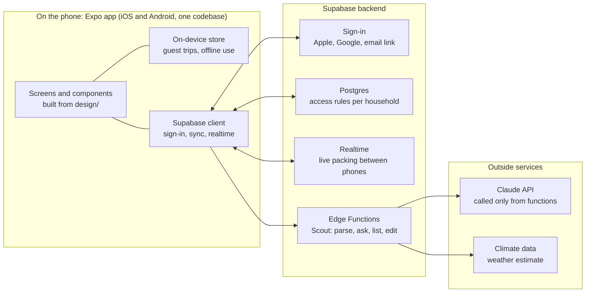
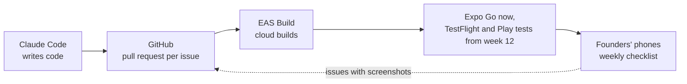

# Architecture

The app talks only to Supabase, and only Supabase talks to Claude. The Claude API key never ships inside the app.

## When each part arrives

| Part | Built in | Notes |
| --- | --- | --- |
| Expo app, on-device store, rule-based lists | Weeks 2 to 5 | No backend needed. Guest-first is a product rule, so everything starts on the phone. |
| Supabase project, Edge Functions, Claude API | Weeks 5 to 8 | Supabase is created in week 5 so Scout's server work starts cleanly in week 6. |
| Sign-in, cloud database, sync | Week 9 | Guest trips move to the account without regenerating. |
| Realtime, invites, presence | Week 11 | Data model is shared-household from day one, so this adds no migration. |
| Crash reporting, usage events | Week 12 | Events limited to what the privacy decision allows. |
| Purchases | Only if the app is paid at launch | A store-billing service such as RevenueCat. |

## How code reaches a phone

Until the Apple and Google store accounts exist (week 10), iPhone testing runs in Expo Go. Anything that needs a native module Expo Go doesn't include waits for a development build after week 10.

## Rules

- Secrets live in Supabase secrets and EAS secrets, never in the repo or app code.
- Scout's outputs are validated against a schema in the Edge Function before they reach the app. A failed or invalid response falls back to the rule-based list.
- Every Scout change to a list is returned as a set of proposed edits; the app applies only the ones the user approves.
