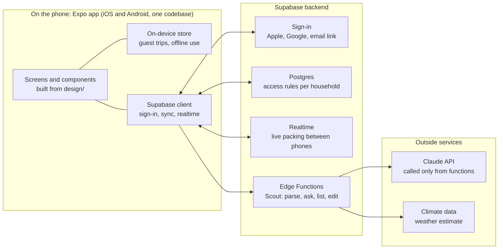
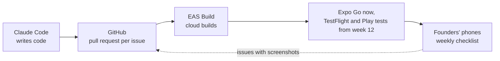
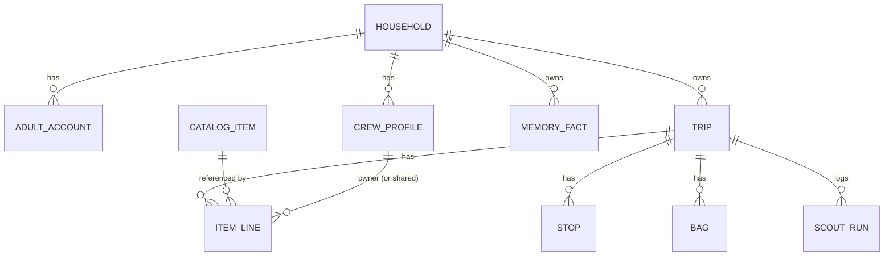

# Architecture

The app talks only to Supabase, and only Supabase talks to Claude. The Claude API key never ships inside the app.

## When each part arrives

| Part | Built in | Notes |
| --- | --- | --- |
| Expo app, on-device store, rule-based lists | Weeks 2 to 5 | No backend needed. Guest-first is a product rule, so everything starts on the phone. |
| Supabase project, Edge Functions, Claude API | Weeks 5 to 8 | Supabase is created in week 5 so Scout's server work starts cleanly in week 6. |
| Sign-in, cloud database, sync | Week 9 | Guest trips move to the account without regenerating. |
| Realtime, invites, presence | Week 11 | Data model is shared-household from day one, so this adds no migration. |
| Crash reporting, usage events | Week 12 | Events limited to what the privacy decision allows. |
| Purchases | Only if the app is paid at launch | A store-billing service such as RevenueCat. |

## How code reaches a phone

Until the Apple and Google store accounts exist (week 9 to 11), iPhone testing runs in Expo Go. Every change passes `scripts/check.sh` in CI before a founder can merge it. Anything that needs a native module Expo Go doesn't include waits for the development build in week 11 (W11-02, issue #26).

## Rules

- Secrets live in Supabase secrets and EAS secrets, never in the repo or app code.
- Scout's outputs are validated against a schema in the Edge Function before they reach the app. A failed or invalid response falls back to the rule-based list.
- Every Scout change to a list is returned as a set of proposed edits; the app applies only the ones the user approves.

## The hard boundary

The phone talks only to Supabase. Only Supabase Edge Functions talk to Claude, so the Claude key, Scout's prompts, spend limits and the Scout log stay on the server. Never on the phone: the Claude key, prompts, or any other household's data.

## Data model (proposed; W2-08 settles the fields)

- Every row carries its household; the access rules check it on every read and write.
- Children exist only as crew profiles: a first name plus age or birth month and year, per decision 13 (open).
- A memory fact is `proposed` until a parent says yes; it records its source trip and when it was last used.
- Guest trips use the same shape on the phone and move to the server unchanged at sign-up.
- The catalog is shared and read-only; it is not owned by a household.

## How a Scout run works and fails

Scout is a set of bounded jobs (parse notes, ask questions, build additions, propose changes, propose memories), each one model call inside an Edge Function. It is not an autonomous agent.

1. Assemble a compact trip and family summary within a token budget per job.
2. Call the model with a JSON output schema for that job.
3. Validate: schema, catalog match (or an explicit custom flag), quantity bounds, duplicates.
4. Classify the outcome, return it, and write one `scout_runs` row.

| Failure | What the function does | Retries | Parent sees | Outcome logged |
| --- | --- | --- | --- | --- |
| Timeout or server error | Retry once with backoff, inside the latency budget | 1 | Catalog list with the honest failure screen | `fallback: timeout` |
| Not valid JSON or wrong schema | One repair call that includes the validation error | 1 | Same, if the repair fails | `repaired` or `fallback: schema` |
| Some lines invalid | Keep the valid lines, drop the rest | 0 | Scout's list | `partial` with the count dropped |
| Too many lines invalid (threshold in the spec, decision 32) | Treat as a failed run | 0 | Catalog list | `fallback: quality` |
| Refusal or empty answer | No retry | 0 | Catalog list | `fallback: empty` |
| Guest limit, rate limit or spend cap | No call | 0 | Catalog list with a plain message | `fallback: limit` |

Rule: no code path returns an empty or trimmed Scout result as a success. `scout_runs` holds job, prompt version, model, effort, outcome, reason, latency, tokens, cost and lines added or dropped. Fallback, partial and dropped-line rates feed the week 8 pass mark and the beta alerts.

## Evals (feeds W7-03 and W8)

- Deterministic tests on every PR: validator, quantity math, and that no Scout output changes a list without a preview.
- The eval set: the 20 test trips (5 held out and never used while tuning prompts), the 30 parent utterances, and about 15 adversarial cases. Every real edge case from beta is added.
- Code graders first (schema validity, invented items, quantity errors, duplicates, latency, cost, fallback and partial rates). Founders' grades are the gold standard. A model grader only after it agrees with founders' grades at the bar set in week 8.
- A 5-trip smoke run in `scripts/check.sh` for any change under Scout; the full run before each beta build.
- The runtime model per job is chosen by eval score per dollar against decision 11.

## Where each fact lives (drift control)

| Fact | Home (wins any conflict) | Copies | Kept in step by |
| --- | --- | --- | --- |
| Tasks, dates, owners | Tracker (Drive) | GitHub issues | Claude rewrites each week's issues from the tracker |
| Decisions | Tracker, Decisions tab | "Decided" in `CLAUDE.md`, later `docs/spec-v2.md` | Sync after each weekly meeting; date checked by `session-start` and `check.sh` |
| Behaviour | `docs/spec-v2.md` | Issue contracts quote it | Spec changes only by PR |
| Look | Design canvas (Claude) | `design/` export, `DESIGN.md`, tokens | Export PR after any canvas change |
| Scope | Spec v2 scope section | None | A later item moves up only with evidence from 3 or more testers |
| How we work | Overview doc (Drive) | Project instructions, `CLAUDE.md` | Edited the same day |
| Scout prompts and quality | `supabase/functions` and `eval/` | None | `scout-change` skill |
| Lessons | `docs/lessons.md` | None | `session-end` skill |

Every session opens with the `session-start` skill and closes with `session-end`. Once a week, the first session after the last audit is 7 or more days old also runs the full drift audit (session-start step 5): it compares every home with its copies and appends each finding to the tracker's Drift log tab, which the founders settle at step 0 of the weekly meeting.
